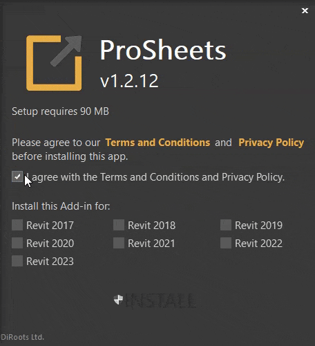
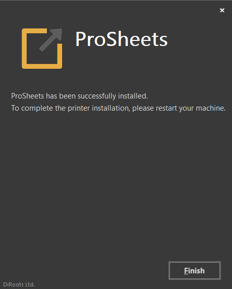
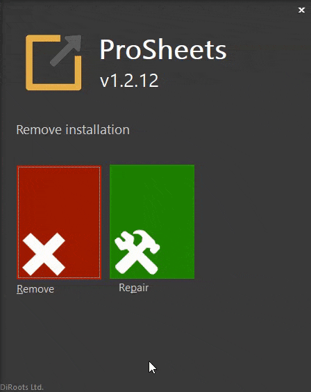

# Getting Started
{: .no_toc }

Try DiStem free for 15 days. To purchase a license, contact our [sales team](mailto:sales@diroots.com).
{: .fs-6 .fw-300 }

## Table of contents
{: .no_toc .text-delta }

1. TOC
{:toc}

---

## Download

Download the [latest version of DiStem](https://diroots.com/revit-plugins/distem-bundle-for-autodesk-revit/).


## Install

### Compatibility
- Revit 2019–2027.
- Use a Windows version supported by your Revit release. See [Autodesk's system requirements](https://www.autodesk.com/support/technical/article/caas/sfdcarticles/sfdcarticles/System-requirements-for-Autodesk-Revit-products.html).

### Prerequisites
- Admin permissions.

DiStem is installed for all users on the machine. Its add-in files are stored in `%ProgramData%\Autodesk\Revit\Addins\`.
{: .note }

### Standard Installation

This method is intended for users with administrator permissions who want to install DiStem on one computer.

1. Close Revit.

2. Run the installer.

3. Select the Revit versions and click 'Install'.

   

4. Wait for the installation to complete and click 'Finish'.

   

### Silent Installation

This method is intended for IT administrators who want to deploy DiStem to multiple computers.

- Install for all compatible Revit versions.

  ```cmd
  <installer-name>.exe /i // /qn accept_eula=1
  ```

- Disable automatic update checks during installation.

  ```cmd
  <installer-name>.exe /i // /qn accept_eula=1 UPDATER="FALSE"
  ```

- Exclude specific Revit versions.

  ```cmd
  <installer-name>.exe /i // /qn accept_eula=1 revit2019=""
  ```

## Uninstall

### Using the installer User Interface

1. Run the installer.

2. Select and click 'Remove'.

   

3. Wait for the uninstallation to complete, then click 'Finish'.

### Using the installer silently

Uninstall the app without user interaction.

```cmd
<installer-name>.exe /x // /qn
```

### From the control panel

1. In the search box on the taskbar, type Control Panel and select it from the results.

2. Select Programs > Programs and Features.

3. Select the program you want to remove and select Uninstall or Uninstall/Change. Then follow the directions on the screen.

## Updates

This app includes an updater to help you keep it up to date. 
The updater will:
- notify you whenever a new version is released (the action is triggered on Revit close event).
- ask you to install now or to remind you tomorrow.


### Updater Settings

The updater checks for updates every two days by default. You can change the frequency and download folder.

By default, update checks cannot be disabled in the updater settings. To check less often, set the frequency to 365 days.
{: .tip }

**Pro Tip for IT administrators:** To change how often DiStem checks for updates across the machine, edit `%ProgramData%\DiStem\Settings\updater.ini`. Change `CheckFrequency=2` to `CheckFrequency=365`.
{: .tip }

We recommend keeping DiStem up to date. Support is not provided for outdated versions.
{: .important }
